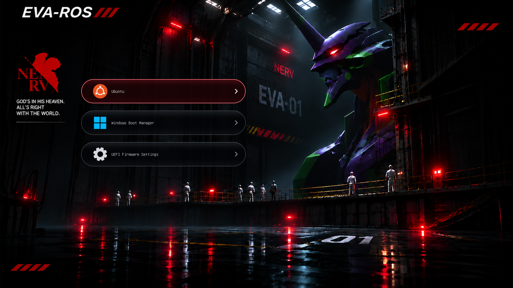

# EVA-ROS GRUB Theme

EVA-01 Dark theme draft for GRUB2, organized in a flat theme directory similar to Minegrub.

**Status: Phase 2 complete for visual review; Phase 3 GRUB/VM testing has not started. Not a production-ready installer.** Installation apply remains gated. No bootloader binaries or firmware settings have been changed during development.



## Design

- Offline preview: **1920 × 1080**, font size **16**.
- Intended first entries: Ubuntu, Windows Boot Manager, UEFI Firmware Settings.
- Icons remain visible for selected and unselected entries.
- Additional entries, recovery and submenus must remain accessible.
- Red selected outline, dark capsule buttons and a restored EVA-01 background.

Preview order and icons describe the target design. Native ordering and classes for UEFI/Advanced still need implementation and verification. Offline images are not screenshots of a running GRUB instance. The background has been restored using imagegen and is not pixel-identical to the supplied reference.

Open [preview.html](preview.html) locally to compare the states and reference.

## Layout

```text
install.sh                 # plan only by default
rollback.sh
preview.html
eva-ros/
  theme.txt
  background.png
  item_*.png
  selected_item_*.png
  icons/
artwork/                   # offline previews, restoration prompt and metadata
scripts/                   # generation, checks, diagnostic and installation manager
tests/                     # safety checks and pending acceptance gates
config/                    # baseline example only; real baseline stays private
references/                # approved artwork and credited Minegrub reference
```

## Local checks

Python 3 with Pillow and NumPy is required for artwork/static checks. Dependency names are listed in requirements.txt. No automatic dependency installation is performed.

```bash
python3 scripts/validate-assets.py
python3 tests/test-safety.py
bash install.sh
```

`install.sh` without flags only prints a plan and does not need sudo. A successful plan does not mean the theme is ready to install. Apply is blocked by pending acceptance checks; do not mark unrun tests as passed.

To regenerate the code-defined UI and previews:

```bash
python3 scripts/build-ui.py
```

This also needs Ubuntu's `/usr/share/grub/unicode.pf2`. It renders an approximation using the local font file, whose internal name may differ from the font embedded in signed GRUB. It does not repeat the AI background restoration.

## Before real installation

Read [testing status](docs/STATUS.md) and [installation notes](docs/INSTALLATION.md). GRUB/VM, Secure Boot font behavior, native icon classes/order, real boot paths and rollback need verification. Keep the existing firmware and Secure Boot configuration unless separately authorized.

Machine diagnostics, filesystem UUIDs and private baseline hashes are deliberately omitted from this shareable snapshot. A real, reviewed baseline belongs in `config/local-machine.json`, which is ignored by Git. Merely copying the example does not satisfy validation or acceptance gates.

## Credits and licensing status

See [THIRD_PARTY.md](THIRD_PARTY.md). This snapshot does not assign a blanket license to artwork, trademarks, fonts or all project code.
